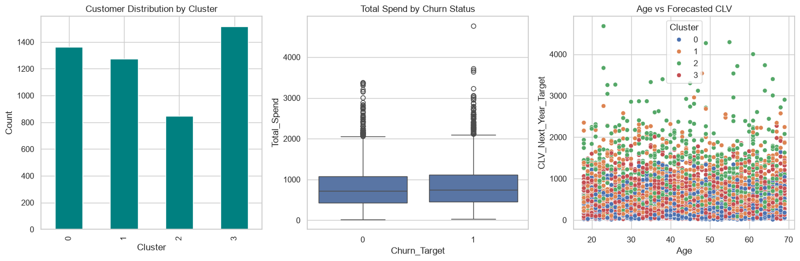

# Customer 360 Analytics Pipeline

An end-to-end Machine Learning pipeline for Customer Segmentation (K-Means), Churn Prediction (Random Forest), and CLV Forecasting (Linear Regression).

---

## Tech Stack
* **Language:** Python
* **Libraries:** Pandas, NumPy, Scikit-Learn, Matplotlib, Seaborn
* **Environment:** VS Code / Jupyter Notebook

---

## Visual Insights & Analytical Dashboard

The generated dashboard (`customer360_dashboard.png`) provides three primary analytical views:

1. **Customer Volume by Cluster:** Displays the distribution and count of customers across segmented tiers to identify core user bases.
2. **Total Spend vs. Churn Risk:** Contrasts spending behavior between high-risk and low-risk cohorts to highlight attrition thresholds.
3. **Account Age vs. Forecasted CLV:** Illustrates how customer tenure correlates with long-term projected revenue across clusters.



---

## Project Structure
```text
customer360_analytics/
├── customer_analytics.csv               # Dataset
├── customer_segmentation_analysis.ipynb # Jupyter Notebook
├── customer360_dashboard.png            # Visual Insights Dashboard
└── README.md                            # Documentation
```

---

## Quick Start
1. Install required dependencies:
   ```bash
   pip install pandas numpy scikit-learn matplotlib seaborn
   ```
2. Open `customer_segmentation_analysis.ipynb` in VS Code or Jupyter Notebook and run all cells sequentially.

---

## Author
**Umme Safrana Tabassum**  
Aspiring Data Scientist & Machine Learning Analyst
