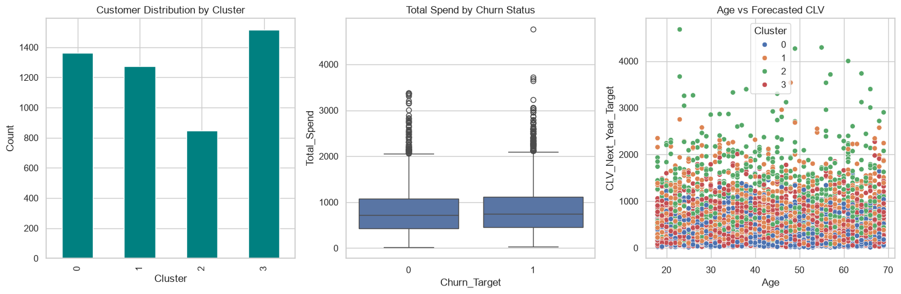

# Customer 360 Analytics Pipeline

An end-to-end Machine Learning pipeline for Customer Segmentation (K-Means), Churn Prediction (Random Forest), and Customer Lifetime Value (CLV) Forecasting (Linear Regression), unified through a real-time Python inference API.

---

## Tech Stack
* **Language:** Python
* **Libraries:** Pandas, NumPy, Scikit-Learn, Matplotlib, Seaborn
* **Environment:** VS Code / Jupyter Notebook

---

## Key Features
* **Customer Segmentation:** Uses K-Means Clustering to group customers into distinct behavioral tiers based on account tenure, order volume, and average order value.
* **Churn Risk Prediction:** Utilizes a Random Forest Classifier to detect high-risk customers early, enabling proactive retention strategies.
* **CLV Forecasting:** Employs Linear Regression to project next-year financial contribution per customer.
* **Unified Customer 360 API:** Integrates all three trained models into a single lookup function for instant, customer-level analytical profiles.

---

## Customer 360 API Engine

The master inference function `get_customer_360_analytics()` retrieves a complete behavioral and financial profile for any individual customer by their `Customer_ID`.

```python
# Query unified customer insights by ID
profile = get_customer_360_analytics("CUST-10002")
print(profile)
```

**Sample Output:**
```json
{
    "Customer ID": "CUST-10002",
    "Assigned Cluster": 3,
    "Churn Prediction": "High Risk of Churn",
    "Forecasted Next Year CLV": "$311.53"
}
```

---

## Visual Insights

The automated analytical dashboard (`customer360_dashboard.png`) summarizes model outputs into three clear visual components:

1. **Customer Volume by Cluster:** Displays the distribution and count of customers across segmented tiers to identify core user bases.
2. **Total Spend vs. Churn Risk:** Contrasts spending behavior between high-risk and low-risk cohorts to highlight attrition thresholds.
3. **Account Age vs. Forecasted CLV:** Illustrates how customer tenure correlates with long-term projected revenue across clusters.



---

## Project Structure
```text
customer360_analytics/
├── customer_analytics.csv               # Structured customer dataset
├── customer_segmentation_analysis.ipynb # End-to-end modeling, API & visualization notebook
├── customer360_dashboard.png            # Exported analytical dashboard
└── README.md                            # Project documentation
```

---

## How to Run
1. **Install required dependencies:**
   ```bash
   pip install pandas numpy scikit-learn matplotlib seaborn
   ```
2. **Execute the pipeline:**
   Open `customer_segmentation_analysis.ipynb` in **VS Code** or **Jupyter Notebook** and run all cells sequentially to train the models, test the API function, and generate the dashboard visuals.

---

## Author
**Umme Safrana Tabassum**  
Aspiring Data Scientist & Machine Learning Analyst